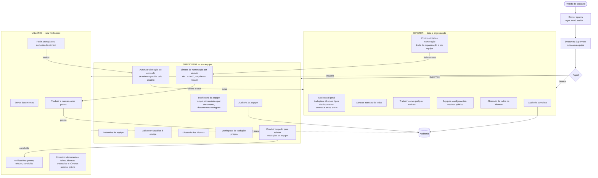
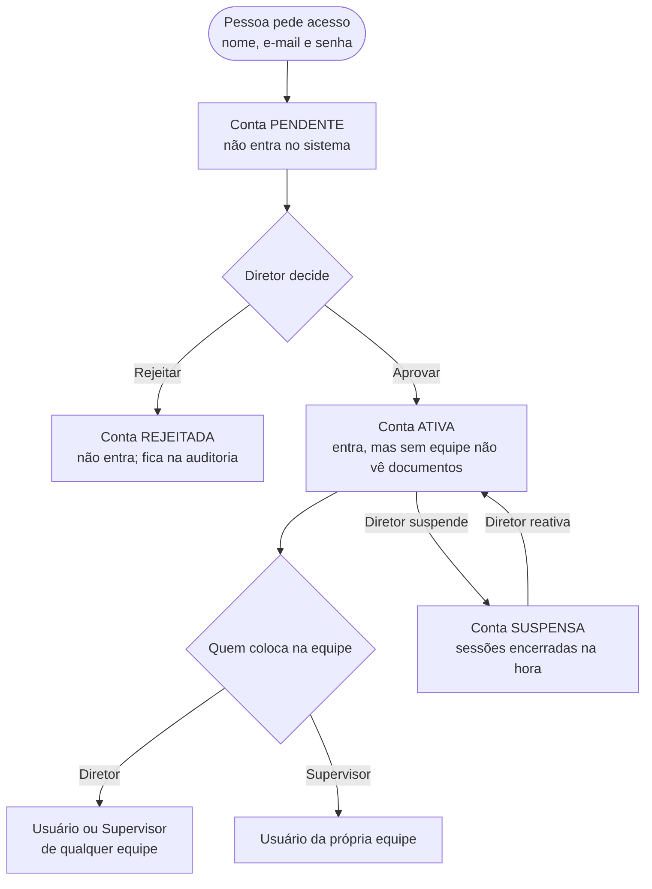
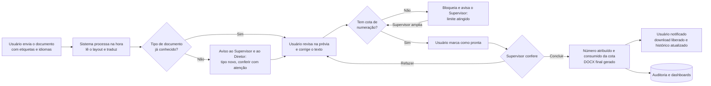
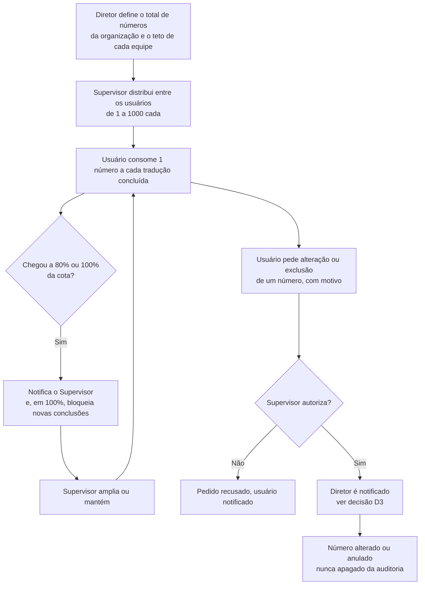

# Planejamento — acessos por hierarquia (Diretor, Supervisor, Usuário)

> Estado: **implementado** (2026-10-18, [ADR-011](../decisions/011-hierarchy-numbering-dashboards.md), migração `0011`). Decisões D2–D7 seguem as propostas da seção 8; D1 foi decidida: cadastro sem mudança. Este documento descreve o que cada nível de acesso faz, o fluxo de um documento do envio à entrega e o que precisa mudar no sistema atual. As decisões em aberto estão no fim e precisam de resposta antes da implementação.

## Nomes

| Nome no pedido | Nome no sistema hoje | Onde atua |
| --- | --- | --- |
| **Diretor** | Diretor (`org_role = director`) | Toda a organização |
| **Supervisor** (líder, supervisor de projetos) | Líder (`team_role = leader`) | A(s) equipe(s) que supervisiona |
| **Usuário** (tradutor) | Operador (`team_role = operator`) | O próprio workspace |

A tela passará a mostrar **Supervisor** e **Usuário**; os nomes internos podem continuar `leader`/`operator`.

## Regra de ouro: o trabalho de cada usuário é dele

- Documentos, traduções e números usados por um usuário **só são editados por ele e pelo Supervisor responsável por ele**.
- O Diretor **vê tudo e altera tudo do sistema** (equipes, configurações, glossário, limites, acessos), **menos o trabalho de cada usuário**: nesse caso ele autoriza, não edita.
- Toda ação de qualquer pessoa vai para a **auditoria**, que é somente inserção e não pode ser apagada.

## 1. Fluxograma geral de acessos

### 1.1 O que é "cadastro aprovado" (regra atual, mantida)

As regras de cadastro **não mudam** com este plano. Uma conta só entra no sistema depois que o Diretor a aprova; o lugar na hierarquia (equipe e papel) é dado depois, na tela de Equipes.

| Estado | Entra no sistema? | Quem muda |
| --- | --- | --- |
| Pendente | Não | Diretor aprova ou rejeita |
| Ativo | Sim; vê documentos só depois de entrar numa equipe | Diretor suspende |
| Rejeitado | Não | — |
| Suspenso | Não; sessões abertas caem na hora | Diretor reativa |

Regras (já em vigor):
- Só o **Diretor** aprova, rejeita, suspende e reativa contas.
- O **Diretor** coloca qualquer pessoa ativa em qualquer equipe, como Usuário ou Supervisor; o **Supervisor** só adiciona Usuários à própria equipe.
- Ninguém se dá papel mais alto, e o Diretor não ocupa papel de equipe (ADR-005).
- Cada aprovação, rejeição, suspensão, reativação e mudança de equipe vai para a auditoria.

## 2. Fluxograma de um documento (do envio à entrega)

## 3. Fluxograma da numeração (cota, alteração e exclusão)

## 4. O que cada um vê e faz (matriz)

| Recurso | Diretor | Supervisor | Usuário |
| --- | --- | --- | --- |
| Dashboard geral (organização) | ✅ | ❌ | ❌ |
| Dashboard da equipe (tempos, entregas) | ✅ todas | ✅ só as suas | ❌ |
| Relatórios | ✅ | ✅ da equipe | ❌ |
| Auditoria | ✅ completa | ✅ da equipe | ❌ |
| Aprovar cadastros | ✅ todos | ❌ (regra atual) | ❌ |
| Colocar pessoas na equipe | ✅ qualquer papel | ✅ Usuários na própria equipe | ❌ |
| Equipes, papéis e configurações | ✅ | ❌ | ❌ |
| Tradutor público e livro | ✅ | ❌ | ❌ |
| Glossário | ✅ | ✅ | 👁️ consulta |
| Limite de numeração da organização/equipe | ✅ | ❌ | ❌ |
| Cota de numeração por usuário (1–1000) | ✅ | ✅ da equipe | 👁️ a própria |
| Autorizar alteração/exclusão de número | ✅ ciente/autoriza (D3) | ✅ | ❌ (só pede) |
| Enviar documentos | ✅ | ✅ | ✅ (hoje não pode — muda) |
| Traduzir e marcar como pronta | ✅ | ✅ | ✅ |
| Concluir ou pedir para refazer | ✅ | ✅ da equipe | ❌ |
| Editar o trabalho de um usuário | ❌ só autoriza | ✅ dos seus usuários | ✅ o próprio |
| Notificações | ✅ | ✅ | ✅ |
| Histórico próprio (feitos, idiomas, protocolos, números, prévia) | ✅ | ✅ | ✅ |
| Downloads | ✅ tudo | ✅ da equipe | ✅ os próprios |

## 5. Espaços (telas) de cada papel

### Diretor
1. **Dashboard** (tela inicial)
   - Total de traduções no período, com comparação ao período anterior.
   - **Idiomas**: gráfico de rosca com a participação de cada par (PT→EN, EN→PT…).
   - **Tipos de documento**: barras horizontais ordenadas — mais e menos traduzidos (rosca fica ilegível com muitos tipos).
   - **Acertos e erros por tipo de documento**: barras empilhadas em % (concluído de primeira × refeito × concluído com justificativa).
   - **Numeração**: números usados × disponíveis por equipe (barra de progresso). Cada tradutor juramentado tem a própria numeração e máscara ([ADR-012](../decisions/012-sworn-translators-masks.md)).
   - Filtros: período, equipe, idioma, tipo.
2. Cadastros pendentes · Usuários · Equipes · Configurações · Glossário · Numeração · Auditoria · Traduções · Downloads · Notificações.

### Supervisor
1. **Dashboard da equipe** (tela inicial)
   - Documentos entregues no período e em andamento.
   - **Tempo por usuário**: tempo médio do envio à conclusão e da revisão (barras por pessoa).
   - **Tempo por documento**: lista ordenável com tempo de cada etapa (processamento, revisão, conclusão).
   - **Cotas de numeração**: uso de cada usuário com alerta em 80% e 100%.
2. Fila para concluir · Workspace próprio · Numeração da equipe · Pedidos de alteração de número · Relatórios · Auditoria da equipe · Equipe (adicionar Usuários) · Glossário.

### Usuário (workspace)
1. **Meu workspace** (tela inicial): enviar documento, documentos em andamento, notificações.
2. **Histórico**: documentos finalizados, idioma, número/protocolo usado, data, prévia do documento final.
3. **Minha cota**: números usados e disponíveis; pedir alteração ou exclusão de número.

## 6. O que muda no sistema atual

| Área | Hoje | Planejado |
| --- | --- | --- |
| Envio | Só Diretor e Líder enviam | Usuário também envia, para a própria equipe |
| Dono do trabalho | Tradução é da equipe | Cada tradução tem um **responsável** (quem enviou ou a quem foi atribuída); só ele e seu Supervisor editam |
| Diretor | Edita qualquer rascunho | Vê tudo; no trabalho de um usuário só autoriza |
| Auditoria | Só Diretor | Supervisor vê a da própria equipe |
| Cadastro | Só Diretor aprova | **Sem mudança** |
| Numeração | Contador único por ano, livro e folha | Cotas: organização → equipe → usuário; alertas; pedidos de alteração/anulação com autorização |
| Dashboards | Não existem | Diretor (organização) e Supervisor (equipe) |
| Relatórios | Não existem | Exportação CSV/PDF dos dashboards e das listas filtradas |
| Histórico do usuário | Lista de traduções | Workspace com histórico, números usados e prévia |

### Dados novos (rascunho)

- `translation_jobs.assignee_id` (responsável) e marcos de tempo por etapa (`processed_at`, `review_started_at`, `submitted_at` já existe, `approved_at` já existe) para medir tempos.
- `numbering_quotas` (escopo: organização, equipe ou usuário; limite; usados) com histórico de ajustes.
- `numbering_change_requests` (número, tipo: alterar/anular, motivo, pedido por, autorizado por, estado).
- `translation_jobs.redo_count` para medir "acerto de primeira" (hoje dá para calcular pela auditoria `translation.returned`).
- Visões agregadas (por dia, equipe, idioma, tipo) para os dashboards não pesarem.

## 7. Ordem de implementação sugerida

1. **Responsável e permissões** — `assignee_id`, Usuário envia, regra "só o dono e o seu Supervisor editam", auditoria por equipe para o Supervisor (cadastro sem mudança).
2. **Numeração com cotas** — limites organização/equipe/usuário, consumo na conclusão, alertas 80%/100%, bloqueio, pedidos de alteração/anulação.
3. **Workspace e histórico do usuário** — telas do Usuário com histórico, números e prévia.
4. **Dashboard do Supervisor** — tempos e entregas.
5. **Dashboard do Diretor** — traduções, idiomas, tipos, acertos/erros em %.
6. **Relatórios** — exportação CSV/PDF.

Cada etapa sai com testes de permissão (permitido e negado para os três papéis) e entrada na auditoria.

## 8. Decisões em aberto

| # | Pergunta | Proposta |
| --- | --- | --- |
| D1 | O Supervisor aprova cadastros? | **Decidido (2026-10-18): não.** As regras de cadastro atuais ficam como estão (seção 1.1) |
| D2 | "Números" são a numeração da Tradução Pública (nº/ano, livro e folha)? | Sim; a cota limita quantas traduções cada usuário pode concluir |
| D3 | Alterar/anular número precisa do Supervisor **e** do Diretor, ou do Supervisor com o Diretor apenas avisado? | Supervisor autoriza; Diretor é notificado e pode reverter |
| D4 | O Diretor pode editar o trabalho de um usuário em algum caso (ex.: usuário desligado)? | Não edita; reatribui a outro usuário, que passa a ser o responsável |
| D5 | "Acerto" e "erro" de um tipo de documento | Acerto = concluído sem "refazer" e sem justificativa; erro = teve "refazer" ou conclusão com justificativa |
| D6 | O limite de 1 a 1000 vale por período (mês/ano) ou é total? | Por ano, acompanhando a numeração anual |
| D7 | Número anulado pode ser reutilizado? | Não: fica anulado com motivo, por exigência do livro de traduções |
